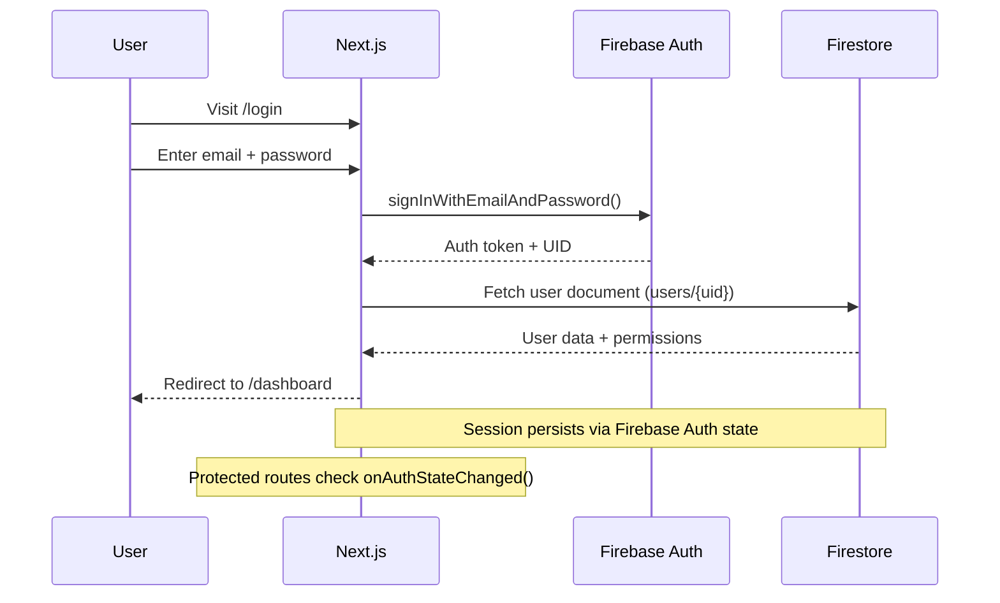
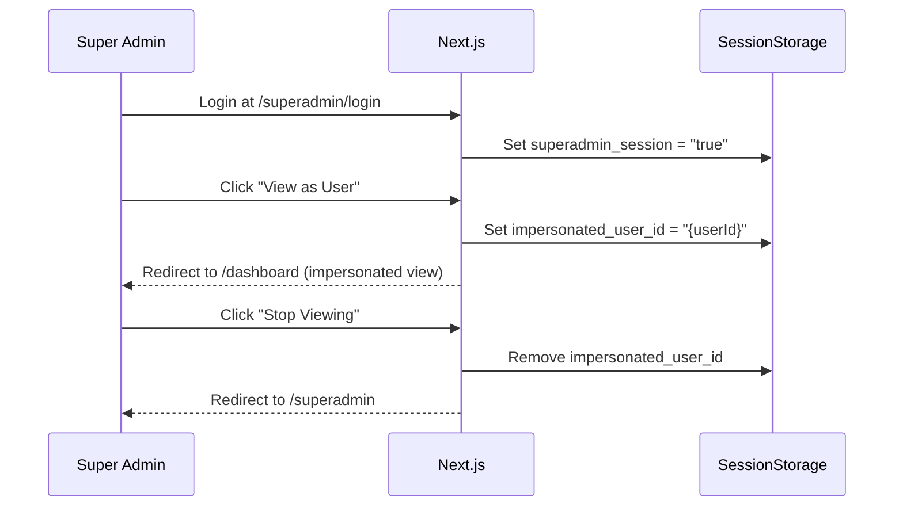

<div align="center">

<!-- BANNER -->


<br/>

[](https://nextjs.org/)
[](https://reactjs.org/)
[](https://www.typescriptlang.org/)
[](https://firebase.google.com/)
[](https://tailwindcss.com/)
[](https://vercel.com/)
[](./LICENSE)
[](https://github.com/Manthan174)

<br/>

> 💎 **The ultimate cloud-based business management suite designed exclusively for modern jewellers.**  
> Manage billing, inventory, party ledgers, employees, and finances — all in one place.

<br/>

[🚀 Live Demo](https://ndsuhagiya.com) · [📖 Documentation](#-table-of-contents) · [🐛 Report Bug](https://github.com/Manthan174/N-D-SUHAGIYA/issues) · [✨ Request Feature](https://github.com/Manthan174/N-D-SUHAGIYA/issues)

</div>

---

## 📋 Table of Contents

- [About the Project](#-about-the-project)
- [Features](#-features)
- [Tech Stack](#-tech-stack)
- [Project Structure](#-project-structure)
- [Getting Started](#-getting-started)
- [Environment Variables](#-environment-variables)
- [Screenshots](#-screenshots)
- [API Reference](#-api-reference)
- [Database Structure](#-database-structure)
- [Authentication Flow](#-authentication-flow)
- [User Roles](#-user-roles)
- [Security](#-security)
- [Performance](#-performance)
- [Responsive Design](#-responsive-design)
- [Deployment](#-deployment)
- [Roadmap](#-roadmap)
- [Contributing](#-contributing)
- [License](#-license)
- [Contact](#-contact)
- [Support](#-support)

---

## 🌟 About the Project

**N D Suhagiya** is a full-stack, cloud-native **Jewellery Business Management Platform** built with the latest Next.js 16 App Router. It provides jewellers and gold/silver traders with a comprehensive digital ecosystem to run their entire business operations.

### 🎯 Real-World Use Cases

| Use Case | Description |
|----------|-------------|
| 🏪 **Retail Jewellers** | Manage daily billing, customer ledgers, and inventory in real time |
| 🏢 **Wholesale Traders** | Track silver/gold fine balances across multiple parties |
| 📊 **Business Analytics** | Visualize revenue, outstanding amounts, and stock trends |
| 👥 **Multi-Staff Shops** | Manage employee profiles, roles, and access permissions |
| 🌐 **Multi-Tenant SaaS** | Super Admins onboard and manage multiple jeweller businesses |
| 💰 **Finance Management** | Track income, expenses, and account balances with full audit trail |

### 💡 Why N D Suhagiya?

> Traditional jewellery shops rely on manual ledgers, paper bills, and spreadsheets — leading to errors, delays, and data loss.
> **N D Suhagiya eliminates all of that** by providing an intelligent, real-time, cloud-synchronized platform that works on any device.

---

## ✨ Features

<details>
<summary>🧾 <strong>Billing & Invoicing</strong> — Click to expand</summary>

- Generate professional GST-compliant bills in seconds
- Automatic bill numbering with custom starting number
- Export bills to **PDF** with Gujarati font support
- Bill history with search and filtering
- Items list management (Ring, Chain, Bracelet, etc.)

</details>

<details>
<summary>📦 <strong>Stock Management</strong> — Click to expand</summary>

- Real-time inventory tracking for gold & silver items
- Add, edit, delete stock entries
- Category-wise stock overview
- Instant search and filtering

</details>

<details>
<summary>👥 <strong>Party Ledger</strong> — Click to expand</summary>

- Manage customers, clients, and business partners
- Track outstanding amount (₹) and fine (grams) per party
- Collect payment with real-time balance update
- International mobile number support with country codes

</details>

<details>
<summary>👨‍💼 <strong>Employee Module</strong> — Click to expand</summary>

- Add and manage team members with photo upload
- Category-based roles (Manager, Goldsmith, Sales Executive, etc.)
- Profile cards with contact details and address
- Responsive grid/table view

</details>

<details>
<summary>💼 <strong>Finance & Accounts</strong> — Click to expand</summary>

- Income and expense tracking with document uploads
- Account balance visualization with Recharts
- Filter by date range and category
- Export financial records

</details>

<details>
<summary>🛡️ <strong>Super Admin Panel</strong> — Click to expand</summary>

- Manage subscription, trial, and whitelabel users
- Toggle module-level permissions per user (live toggle)
- Impersonate user dashboards for support
- Dynamic module generator — create new pages from the admin UI
- Real-time user activity and statistics

</details>

<details>
<summary>⚙️ <strong>Settings & Customization</strong> — Click to expand</summary>

- Company profile with logo upload
- Language switcher (English / Gujarati)
- Custom items list, starting bill number
- Theme and branding options

</details>

---

### 🏆 Feature Highlights

| Feature | Status |
|---------|--------|
| ☁️ Real-time data sync via Firestore | ✅ Live |
| 🧾 PDF bill generation with Gujarati font | ✅ Live |
| 🛡️ Role-based module permission system | ✅ Live |
| 🔧 Dynamic module generator from Admin UI | ✅ Live |
| 📱 Fully responsive (Mobile / Tablet / Desktop) | ✅ Live |
| 🌐 Multi-language support (EN / gu-IN) | ✅ Live |
| 📸 Firebase Cloud Storage for photos & docs | ✅ Live |
| 📊 Analytics & Charts with Recharts | ✅ Live |
| 🗑️ Trash & restore deleted records | ✅ Live |
| 🔔 WhatsApp integration for user contact | ✅ Live |

---

## 🛠 Tech Stack

| Layer | Technology | Version | Purpose |
|-------|-----------|---------|---------|
| **Frontend Framework** |  | 16.2.7 | Full-stack React framework with App Router |
| **UI Library** |  | 19.x | Component-based UI rendering |
| **Language** |  | 5.x | Type-safe development |
| **Styling** |  | 4.x | Utility-first responsive CSS |
| **Icons** |  | 1.x | Beautiful SVG icon library |
| **Database** |  | 12.x | NoSQL real-time cloud database |
| **Auth** |  | 12.x | Secure email/password authentication |
| **Storage** |  | 12.x | Photo & document file storage |
| **Realtime DB** |  | 12.x | Live settings sync |
| **PDF Engine** |  | 4.x | Bill PDF generation |
| **Charts** |  | 3.x | Analytics and financial charts |
| **API** |  | — | Server-side REST API routes |
| **Deployment** |  | — | Zero-config cloud deployment |
| **Version Control** |  | — | Source control & CI/CD |

---

## 📁 Project Structure

```
n-d-suhagiya/
├── 📁 public/                    # Static assets (images, icons, fonts)
├── 📁 src/
│   ├── 📁 app/                   # Next.js App Router
│   │   ├── 📁 api/               # Server-side API routes
│   │   │   └── 📁 superadmin/
│   │   │       └── 📁 create-module/   # Dynamic module generator API
│   │   │
│   │   ├── 📁 dashboard/         # 🏠 User Dashboard (Protected)
│   │   │   ├── 📄 layout.tsx     # Sidebar navigation + auth guard
│   │   │   ├── 📄 page.tsx       # Main dashboard overview
│   │   │   ├── 📁 billing/       # 🧾 Billing module
│   │   │   ├── 📁 employees/     # 👨‍💼 Employee management module
│   │   │   ├── 📁 finance/       # 💼 Finance & accounts module
│   │   │   ├── 📁 parties/       # 👥 Party ledger module
│   │   │   ├── 📁 session/       # 🕐 Session management
│   │   │   ├── 📁 settings/      # ⚙️ Business settings
│   │   │   ├── 📁 stock/         # 📦 Stock management module
│   │   │   └── 📁 trash/         # 🗑️ Recycle bin
│   │   │
│   │   ├── 📁 superadmin/        # 🛡️ Super Admin Panel (Admin Only)
│   │   │   ├── 📄 layout.tsx     # Admin sidebar + auth
│   │   │   ├── 📁 analytics/     # 📊 Platform analytics
│   │   │   ├── 📁 clients/       # 👤 User management
│   │   │   │   ├── 📁 subscription/  # Subscription users
│   │   │   │   ├── 📁 trial/         # Trial users
│   │   │   │   └── 📁 whitelabel/    # Whitelabel clients
│   │   │   ├── 📁 modules/       # 🔧 Dynamic module generator
│   │   │   ├── 📁 settings/      # Admin settings
│   │   │   └── 📁 view/[userId]/ # 👁️ User impersonation view
│   │   │
│   │   ├── 📁 login/             # 🔑 Authentication pages
│   │   ├── 📁 register/          # 📝 User registration
│   │   ├── 📁 privacy-policy/    # 📜 Legal pages
│   │   ├── 📁 terms-of-service/  # 📜 Legal pages
│   │   ├── 📄 layout.tsx         # Root layout with SEO metadata
│   │   ├── 📄 page.tsx           # 🌐 Public marketing homepage
│   │   └── 📄 globals.css        # Global Tailwind styles
│   │
│   ├── 📁 components/            # Reusable UI components
│   │   ├── 📄 EditUserModal.tsx  # Admin user editor modal
│   │   ├── 📄 UserStatsModal.tsx # User statistics modal
│   │   ├── 📄 WebsiteNavbar.tsx  # Public site navigation
│   │   └── 📄 WebsiteFooter.tsx  # Public site footer
│   │
│   └── 📁 lib/                   # Core utilities & services
│       ├── 📄 firebase.ts        # Firebase app initialization
│       ├── 📄 db.ts              # Firestore CRUD operations
│       ├── 📄 dashboardModules.ts # Single source of truth for modules
│       ├── 📄 pdfGenerator.ts    # Bill PDF generation
│       ├── 📄 translations.ts    # Multi-language strings (EN/Gujarati)
│       ├── 📄 LanguageContext.tsx # Global language provider
│       ├── 📄 admin.ts           # Admin utility functions
│       └── 📄 gujaratiFont.ts    # Embedded Gujarati font for PDF
│
├── 📄 .env                       # Environment variables (git-ignored)
├── 📄 .env.example               # Environment template
├── 📄 .gitignore                 # Git ignore rules
├── 📄 next.config.ts             # Next.js configuration
├── 📄 tailwind.config.ts         # Tailwind CSS configuration
├── 📄 tsconfig.json              # TypeScript configuration
└── 📄 package.json               # Dependencies & scripts
```

---

## 🚀 Getting Started

### Prerequisites

Make sure you have the following installed:

```bash
node >= 18.x
npm  >= 9.x
git  >= 2.x
```

### 1. Clone the Repository

```bash
git clone https://github.com/Manthan174/N-D-SUHAGIYA.git
cd N-D-SUHAGIYA
```

### 2. Install Dependencies

```bash
npm install
```

### 3. Setup Environment Variables

```bash
cp .env.example .env
```

Fill in your Firebase credentials in the `.env` file (see [Environment Variables](#-environment-variables)).

### 4. Run the Development Server

```bash
npm run dev
```

Open [http://localhost:9002](http://localhost:9002) in your browser.

### 5. Build for Production

```bash
npm run build
npm start
```

---

## 🔐 Environment Variables

Create a `.env` file in the root directory. Use the `.env.example` below as a template:

```env
# ==========================================
# FIREBASE CONFIGURATION
# ==========================================
NEXT_PUBLIC_FIREBASE_API_KEY=your_firebase_api_key
NEXT_PUBLIC_FIREBASE_AUTH_DOMAIN=your_project.firebaseapp.com
NEXT_PUBLIC_FIREBASE_DATABASE_URL=https://your_project-default-rtdb.firebaseio.com
NEXT_PUBLIC_FIREBASE_PROJECT_ID=your_project_id
NEXT_PUBLIC_FIREBASE_STORAGE_BUCKET=your_project.firebasestorage.app
NEXT_PUBLIC_FIREBASE_MESSAGING_SENDER_ID=your_sender_id
NEXT_PUBLIC_FIREBASE_APP_ID=1:your_app_id
NEXT_PUBLIC_FIREBASE_MEASUREMENT_ID=G-XXXXXXXXXX

# ==========================================
# BRANDING & SEO
# ==========================================
NEXT_PUBLIC_SITE_NAME=N D Suhagiya
NEXT_PUBLIC_COMPANY_NAME=N D Suhagiya
NEXT_PUBLIC_SITE_TITLE=N D Suhagiya | Premium Jewellery Management Software
NEXT_PUBLIC_SITE_DESCRIPTION=Simplify your jewellery business with billing, party ledger, and stock management.
NEXT_PUBLIC_SEO_KEYWORDS=jewellery software, billing software, gold management, silver ledger
NEXT_PUBLIC_SITE_URL=https://your_site_url.com

# ==========================================
# CONTACT & SOCIAL
# ==========================================
NEXT_PUBLIC_SUPPORT_EMAIL=your_email@example.com
NEXT_PUBLIC_CONTACT_NUMBER=+91 XXXXXXXXXX
NEXT_PUBLIC_COMPANY_ADDRESS=Your City, State, India
NEXT_PUBLIC_TWITTER_HANDLE=@yourhandle
NEXT_PUBLIC_FACEBOOK_URL=https://facebook.com/yourpage
NEXT_PUBLIC_INSTAGRAM_URL=https://instagram.com/yourpage

# ==========================================
# ANALYTICS
# ==========================================
NEXT_PUBLIC_GA_TRACKING_ID=G-XXXXXXXXXX
NEXT_PUBLIC_META_PIXEL_ID=XXXXXXXXXXXXX
```

> ⚠️ **Never commit your `.env` file.** It is already listed in `.gitignore`.

---

## 📸 Screenshots

<div align="center">

| 🏠 Homepage | 📊 Dashboard |
|:-----------:|:------------:|
|  |  |

| 🛡️ Admin Panel | 📱 Mobile View |
|:--------------:|:--------------:|
|  |  |

| 🔑 Authentication | 🧾 Billing |
|:-----------------:|:----------:|
|  |  |

</div>

> 📷 Screenshots will be updated after the first production deployment.

---

## 🔌 API Reference

All API routes are located in `src/app/api/` and follow the Next.js App Router conventions.

### Super Admin APIs

| Method | Endpoint | Description | Auth Required |
|--------|----------|-------------|:-------------:|
| `POST` | `/api/superadmin/create-module` | Dynamically generate a new dashboard module folder + Firestore entry | ✅ Super Admin |

### Request / Response Examples

#### `POST /api/superadmin/create-module`

**Request Body:**
```json
{
  "moduleName": "Analytics"
}
```

**Response:**
```json
{
  "success": true,
  "slug": "analytics",
  "message": "Module 'Analytics' created successfully at /dashboard/analytics"
}
```

**Error Response:**
```json
{
  "error": "Module name is required",
  "status": 400
}
```

---

## 🗄️ Database Structure

The project uses **Firebase Firestore** (NoSQL) and **Firebase Realtime Database**.

### Firestore Collections

<details>
<summary>📋 <strong>users</strong> — Registered business accounts</summary>

```json
{
  "id": "auto-generated",
  "name": "Manthan Suhagiya",
  "shopName": "N D Suhagiya Jewellers",
  "emailId": "user@example.com",
  "mobile": "+91 9876543210",
  "password": "hashed_or_plain",
  "slug": "n-d-suhagiya-jewellers",
  "subscriptionExpiresAt": "2027-01-01T00:00:00.000Z",
  "isActive": true,
  "permissions": {
    "dashboard": true,
    "billing": true,
    "stock": true,
    "employees": true,
    "finance": false,
    "trash": true,
    "settings": true
  },
  "termsAccepted": true,
  "termsAcceptedAt": "2026-01-01T00:00:00.000Z",
  "createdAt": "timestamp"
}
```

</details>

<details>
<summary>📋 <strong>trial_users</strong> — Trial / free tier accounts</summary>

```json
{
  "id": "auto-generated",
  "name": "Test User",
  "shopName": "Test Jewellers",
  "emailId": "trial@example.com",
  "trialExpiresAt": "2026-02-01T00:00:00.000Z",
  "permissions": {},
  "createdAt": "timestamp"
}
```

</details>

<details>
<summary>🧾 <strong>bills</strong> — Generated invoices</summary>

```json
{
  "id": "auto-generated",
  "userId": "user_uid",
  "partyName": "Rajesh Jewellers",
  "billNumber": "001",
  "items": [
    {
      "name": "Ring",
      "wt": "10.5",
      "touch": "91.6",
      "silver": "9.618",
      "lbramt": "500"
    }
  ],
  "createdAt": "2026-07-01T00:00:00.000Z"
}
```

</details>

<details>
<summary>👥 <strong>parties</strong> — Customer / partner ledger</summary>

```json
{
  "id": "auto-generated",
  "userId": "user_uid",
  "name": "Rajesh Jewellers",
  "mobile": "+91 9876543210",
  "address": "123, Ring Road, Ahmedabad",
  "category": "Customer",
  "previousAmount": "15000.00",
  "previousFine": "120.500",
  "createdAt": "timestamp"
}
```

</details>

<details>
<summary>👨‍💼 <strong>employees</strong> — Staff management</summary>

```json
{
  "id": "auto-generated",
  "userId": "user_uid",
  "name": "Ramesh Patel",
  "category": "Goldsmith",
  "mobile": "+91 9876543210",
  "address": "Ahmedabad, Gujarat",
  "photoUrl": "https://storage.googleapis.com/...",
  "createdAt": "timestamp"
}
```

</details>

<details>
<summary>📦 <strong>stock</strong> — Inventory items</summary>

```json
{
  "id": "auto-generated",
  "userId": "user_uid",
  "itemName": "22KT Gold Necklace",
  "category": "Necklace",
  "weight": "25.5",
  "quantity": "3",
  "createdAt": "timestamp"
}
```

</details>

<details>
<summary>💼 <strong>finance</strong> — Income & expenses</summary>

```json
{
  "id": "auto-generated",
  "userId": "user_uid",
  "type": "income",
  "amount": "50000",
  "description": "Gold sale proceeds",
  "documentUrl": "https://storage.googleapis.com/...",
  "createdAt": "timestamp"
}
```

</details>

<details>
<summary>🔧 <strong>superadmin_modules</strong> — Dynamic module registry</summary>

```json
{
  "id": "auto-generated",
  "name": "Analytics",
  "slug": "analytics",
  "icon": "BarChart2",
  "subItems": [
    { "id": "analytics_sales", "name": "Sales Report", "slug": "sales" }
  ],
  "createdAt": "timestamp"
}
```

</details>

### Firebase Realtime Database

```
users/
  {userId}/
    settings/
      companyProfile/
        companyName: "N D Suhagiya"
        logoUrl: "https://..."
        address: "Ahmedabad, Gujarat"
```

---

## 🔑 Authentication Flow



### Super Admin Authentication



---

## 👤 User Roles

| Role | Access Level | Description |
|------|:------------:|-------------|
| 🌐 **Guest** | Public pages only | Can view the marketing website, login, register |
| 💼 **User (Trial)** | Limited dashboard | Access to modules enabled by Super Admin for trial period |
| 💎 **User (Subscription)** | Full dashboard | Access to all permitted modules based on subscription plan |
| 🏷️ **Whitelabel Client** | Branded dashboard | Custom-branded version of the platform |
| 🛡️ **Super Admin** | Full system access | Manages all users, permissions, modules, and platform settings |

### Module-Level Permissions

Each user role can have individual module permissions toggled by the Super Admin:

```
✅ Dashboard    ✅ Billing     ✅ Stock
✅ Party Ledger ✅ Employees   ❌ Finance
✅ Session      ✅ Trash       ✅ Settings
```

Permissions are stored per-user in Firestore and enforced both on the **sidebar** (UI) and at the **page level**.

---

## 🔒 Security

### 🛡️ Security Measures

| Measure | Implementation |
|---------|---------------|
| **Firebase Security Rules** | Firestore rules restrict read/write per `userId` — users can only access their own data |
| **Authentication Guard** | `onAuthStateChanged()` on every protected layout — unauthenticated users are redirected to `/` |
| **Role-based Access Control** | Module permissions stored in Firestore, checked on every render |
| **Protected Routes** | Dashboard and Super Admin routes validate auth state server-side |
| **Session Isolation** | Super Admin uses a separate Firebase app instance to prevent session conflicts with user accounts |
| **Input Sanitization** | All form inputs are validated and sanitized before writing to Firestore |
| **Environment Variables** | All API keys stored in `.env` and never exposed via server-side APIs |
| **HTTPS Only** | Enforced by Vercel deployment — all traffic is TLS encrypted |

### Firestore Security Rules (Example)

```javascript
rules_version = '2';
service cloud.firestore {
  match /databases/{database}/documents {

    // Users can only read/write their own data
    match /bills/{billId} {
      allow read, write: if request.auth != null
        && resource.data.userId == request.auth.uid;
    }

    match /parties/{partyId} {
      allow read, write: if request.auth != null
        && resource.data.userId == request.auth.uid;
    }

    // Only super admin can read all users
    match /users/{userId} {
      allow read: if request.auth != null;
      allow write: if request.auth.token.admin == true
        || request.auth.uid == userId;
    }
  }
}
```

---

## ⚡ Performance

| Optimization | Implementation |
|-------------|---------------|
| **Server-Side Rendering (SSR)** | Next.js App Router enables SSR for fast initial page loads |
| **Static Generation** | Public marketing pages are statically generated at build time |
| **Code Splitting** | Next.js automatically splits bundles per route — only load what's needed |
| **Image Optimization** | Next.js `<Image>` component with lazy loading and WebP conversion |
| **Real-time Caching** | Firebase Realtime Database caches settings locally |
| **Turbo Dev Mode** | Development server uses `--turbo` flag for instant HMR |
| **Firestore Listeners** | `onSnapshot()` provides real-time updates without polling |
| **SEO Optimized** | Proper `<title>`, `<meta>` descriptions, OG tags, and semantic HTML on all pages |
| **Font Optimization** | System fonts used for UI; Gujarati font embedded only in PDF generation |

---

## 📱 Responsive Design

The entire application is built **mobile-first** using Tailwind CSS breakpoints.

| Breakpoint | Width | Layout |
|-----------|-------|--------|
| 📱 **Mobile** | `< 640px` | Card-based layouts, bottom-friendly actions, hamburger nav |
| 📟 **Tablet (iPad)** | `640px – 1024px` | 2-column grids, condensed tables, slide-over sidebar |
| 🖥️ **Desktop** | `> 1024px` | Full sidebar, multi-column tables, expanded modals |

### Responsive Components

- **Sidebar:** Fixed on desktop, slide-over drawer on mobile with backdrop overlay
- **Tables:** Full data table on desktop → stacked card view on mobile
- **Modals:** Full-screen on mobile, centered popup on desktop
- **Forms:** Single-column on mobile, two-column grid on tablet and above

---

## 🚀 Deployment

This project is deployed on **Vercel** with zero configuration.

### Deploy to Vercel

**Option 1: One-click Deploy**

[](https://vercel.com/new/clone?repository-url=https://github.com/Manthan174/N-D-SUHAGIYA)

**Option 2: Manual Deploy**

```bash
# Install Vercel CLI
npm install -g vercel

# Deploy
vercel

# Deploy to production
vercel --prod
```

### Vercel Configuration

```json
{
  "framework": "nextjs",
  "buildCommand": "npm run build",
  "outputDirectory": ".next",
  "installCommand": "npm install",
  "devCommand": "npm run dev"
}
```

> 💡 Set all environment variables from `.env.example` in your **Vercel Project Settings → Environment Variables** before deploying.

---

## 🗺️ Roadmap

```
Phase 1 — Core Platform ✅
```
- [x] User authentication (Firebase Auth)
- [x] Billing & invoice generation with PDF export
- [x] Party ledger with outstanding tracking
- [x] Stock management
- [x] Super Admin panel
- [x] Role-based module permissions
- [x] Employee module
- [x] Finance & accounts module
- [x] Dynamic module generator
- [x] Multi-language support (Gujarati / English)
- [x] Responsive design (Mobile / Tablet / Desktop)

```
Phase 2 — Growth Features 🚧
```
- [ ] 📲 Progressive Web App (PWA) support
- [ ] 📧 Email notifications for bill generation
- [ ] 🔔 Push notifications for payment reminders
- [ ] 📊 Advanced analytics dashboard
- [ ] 🖨️ Thermal printer bill support
- [ ] 🌙 Dark mode
- [ ] 🔗 Payment gateway integration (Razorpay)
- [ ] 📤 Bulk import via Excel/CSV

```
Phase 3 — Enterprise 🔮
```
- [ ] 🏢 Multi-branch support
- [ ] 🤖 AI-powered business insights
- [ ] 📱 Native mobile app (React Native)
- [ ] 🌍 Additional language support
- [ ] 🔌 Third-party integrations (Tally, QuickBooks)

---

## 🤝 Contributing

Contributions are what make the open-source community such an amazing place. Any contributions you make are **greatly appreciated**.

### How to Contribute

1. **Fork** the repository
   ```bash
   # Click the Fork button on GitHub
   ```

2. **Clone** your fork
   ```bash
   git clone https://github.com/YOUR_USERNAME/N-D-SUHAGIYA.git
   cd N-D-SUHAGIYA
   ```

3. **Create a feature branch**
   ```bash
   git checkout -b feature/AmazingFeature
   ```

4. **Make your changes** and commit
   ```bash
   git add .
   git commit -m "feat: Add AmazingFeature"
   ```

   > 📝 Follow [Conventional Commits](https://www.conventionalcommits.org/) — `feat:`, `fix:`, `docs:`, `chore:`, `refactor:`

5. **Push** to your branch
   ```bash
   git push origin feature/AmazingFeature
   ```

6. **Open a Pull Request** on GitHub

### Development Guidelines

- ✅ Write TypeScript — no `any` types unless absolutely necessary
- ✅ Follow the existing file structure and naming conventions
- ✅ Keep components small and reusable
- ✅ Add a module entry in `src/lib/dashboardModules.ts` for any new dashboard module
- ✅ Test on mobile, tablet, and desktop before submitting PR
- ❌ Do not commit `.env` files
- ❌ Do not break existing module permission system

---

## 📄 License

Distributed under the **MIT License**. See [`LICENSE`](./LICENSE) for more information.

```
MIT License

Copyright (c) 2026 Manthan Suhagiya

Permission is hereby granted, free of charge, to any person obtaining a copy
of this software and associated documentation files (the "Software"), to deal
in the Software without restriction, including without limitation the rights
to use, copy, modify, merge, publish, distribute, sublicense, and/or sell
copies of the Software...
```

---

## 📬 Contact

<div align="center">

| Platform | Handle |
|----------|--------|
| 🌐 **Website** | [ndsuhagiya.com](https://ndsuhagiya.com) |
| 👨‍💻 **GitHub** | [@Manthan174](https://github.com/Manthan174) |
| 💼 **LinkedIn** | [linkedin.com/in/manthan-suhagiya](https://linkedin.com/in/manthan-suhagiya) |
| 📧 **Email** | manthansuhagiya028@gmail.com |
| 📞 **Phone** | +91 7990657237 |
| 📍 **Location** | Ahmedabad, Gujarat, India |

</div>

---

## 💖 Support

<div align="center">

If you found this project helpful, please consider giving it a ⭐ star!

[](https://github.com/Manthan174/N-D-SUHAGIYA)

**Every star motivates us to keep building! 🚀**

<br/>

<a href="https://github.com/Manthan174/N-D-SUHAGIYA">
  
</a>

</div>

---

<div align="center">
  <sub>Built with ❤️ by <a href="https://github.com/Manthan174">Manthan Suhagiya</a> in Ahmedabad, India 🇮🇳</sub>
</div>
